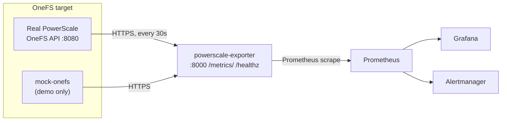

# PowerScale Prometheus Exporter

[](https://github.com/chanawh/pscale-exporter/actions/workflows/ci.yml)

A Prometheus exporter for Dell PowerScale / Isilon storage clusters. It scrapes the OneFS API, auto-discovers the stat keys and endpoints the cluster actually supports, and exposes the results as Prometheus metrics — cluster health, per-node CPU/disk/network, drive health, capacity, quotas, NFS/SMB, and SyncIQ replication lag.

No PowerScale hardware? Every deployment path below has a **demo mode** that runs the exporter against an in-repo mock OneFS cluster instead.

## Features

- **Auto-discovery** — probes the OneFS API at startup and builds the stat map from what the cluster actually serves (no hardcoded key lists to rot)
- **Cluster + node + drive metrics** — health, CPU, memory, disk I/O, network, per-drive busy/latency/queue depth
- **Capacity, quotas, NFS/SMB, SyncIQ** — the storage-level picture, not just host stats
- **Resilient scraper** — retries, timeouts, circuit breaker, tombstoned-node expiry
- **Mock OneFS** — a faithful fake OneFS API (`mock_onefs/`) so the whole stack runs with zero hardware
- **Hardened images** — multi-stage builds, non-root uid `10001`, read-only root filesystem
- **Three deployment paths** — Compose, Kustomize, Helm — all verified end-to-end

## Architecture



The exporter is a FastAPI app (`exporter/`). A background thread polls OneFS on `SCRAPE_INTERVAL`, caches the latest values, and serves them from `/metrics/` in Prometheus format. `/healthz` reports `{"status": "online", ...}` with discovery state (or `503` if the scraper thread has died). `/livez` is the k8s liveness probe (always 200); `/readyz` returns 200 only after the first successful scrape, so a fresh pod never serves empty metrics.

## Quickstart

All three demo paths need no PowerScale hardware — they run against the mock.

### Option A — Docker Compose demo (fastest)

```bash
docker compose -f docker-compose.demo.yml up --build
```

Then open http://localhost:8000/metrics/ (note the trailing slash) and http://localhost:8000/healthz.

### Failure injection (demo only)

The mock can simulate cluster faults so you can watch the dashboard and
alerts react — no hardware needed:

```bash
# Simulate a drive failure (drive 1:1 goes unhealthy + CRITICAL event)
curl -sk -X POST https://localhost:8443/platform/1/faults \
  -H 'Content-Type: application/json' -d '{"scenario":"drive-failure"}'

# Simulate a node going down
curl -sk -X POST https://localhost:8443/platform/1/faults \
  -H 'Content-Type: application/json' -d '{"scenario":"node-down"}'

# Back to healthy
curl -sk -X POST https://localhost:8443/platform/1/faults \
  -H 'Content-Type: application/json' -d '{"scenario":"clear"}'
```

Watch `isilon_drive_health` drop to 0 (fires `PowerScaleDriveFailure`)
or `isilon_node_status` drop (fires `PowerScaleNodeDown`). The CI e2e job
exercises the drive-failure round-trip on every run.

### Option B — kind + Kustomize demo

```bash
kind create cluster --name pscale-demo --image kindest/node:v1.32.0
kubectl apply -k k8s/demo/
kubectl -n powerscale-monitoring rollout status deploy/powerscale-exporter
kubectl -n powerscale-monitoring port-forward svc/powerscale-exporter-clusterip 8000:8000
```

> On Docker Desktop for Windows, pin `kindest/node:v1.32.0`: kind's default v1.37.0 node image fails to initialize there (`kubeadm init` never reaches a ready API server).

### Option C — Helm demo

```bash
helm install pscale ./helm/powerscale-exporter --set mock.enabled=true
kubectl -n powerscale-monitoring rollout status deploy/pscale-powerscale-exporter
kubectl -n powerscale-monitoring port-forward svc/pscale-powerscale-exporter-clusterip 8000:8000
```

## Against a real cluster

### Helm (recommended)

```bash
helm install pscale ./helm/powerscale-exporter \
  --set isilon.host=10.0.0.5 \
  --set isilon.port=8080 \
  --set auth.user=monitor \
  --set auth.password='...'
```

Prefer a pre-created Secret over a command-line password:

```bash
kubectl -n powerscale-monitoring create secret generic onefs-creds \
  --from-literal=ISILON_USER=monitor --from-literal=ISILON_PASS='...'

helm install pscale ./helm/powerscale-exporter \
  --set isilon.host=10.0.0.5 \
  --set auth.existingSecret=onefs-creds
```

See `helm/powerscale-exporter/README.md` for the full values table.

### Kustomize

```bash
kubectl apply -k k8s/manifests/
kubectl -n powerscale-monitoring create secret generic powerscale-exporter-secrets \
  --from-literal=ISILON_USER=monitor --from-literal=ISILON_PASS='...'
```

Edit `ISILON_HOST` in `k8s/manifests/configmap.yaml` first.

### Docker Compose (full stack)

`docker-compose.yml` runs the exporter plus Prometheus, Grafana, and Alertmanager. For clusters reachable only via an SSH jump host, it includes an opt-in `isilon-tunnel` service:

```bash
ISILON_HOST=10.0.0.5 ISILON_PASS='...' docker compose up -d                  # direct connection
ISILON_PASS='...' MGMT_IP=10.0.0.5 JUMPHOST=bastion.example.com SSH_KEY_DIR=~/.ssh \
  docker compose --profile tunnel up -d                                    # via SSH jump host
```

### Manual (bare metal)

```bash
pip install -r requirements.txt
export ISILON_HOST=10.0.0.5 ISILON_USER=monitor ISILON_PASS='...'
cd exporter && python main.py
```

## Metrics

All series carry `cluster_name`. Node series add `node_id`; drive series add `node_id` + `drive_id`.

| Metric | Description |
|--------|-------------|
| `isilon_cluster_health` | Cluster health (1 = OK) |
| `isilon_cluster_capacity_bytes_total` / `isilon_cluster_capacity_bytes_used` | Capacity |
| `isilon_node_status` | Node status (1 = OK) |
| `isilon_node_cpu_value`, `isilon_node_cpu_user_pct`, `isilon_node_cpu_sys_pct`, `isilon_node_cpu_idle_pct` | Node CPU |
| `isilon_node_disk_busy_pct`, `isilon_node_disk_iops_in`, `isilon_node_disk_iops_out` | Node disk I/O |
| `isilon_node_disk_bw_in_bytes`, `isilon_node_disk_bw_out_bytes` | Node disk throughput |
| `isilon_node_net_bytes_in`, `isilon_node_net_bytes_out` | Node network |
| `isilon_node_memory_used_bytes`, `isilon_node_memory_used_gb` | Node memory |
| `isilon_node_last_seen_seconds` | Last successful node scrape (unix ts) |
| `isilon_drive_health` | Drive health (1 = ok) |
| `isilon_drive_busy_pct`, `isilon_drive_latency_ms`, `isilon_drive_queue_depth` | Per-drive performance |
| `isilon_quota_total` | Number of quotas |
| `isilon_nfs_export_count`, `isilon_smb_share_count` | NFS exports / SMB shares |
| `isilon_replication_lag_seconds` | SyncIQ replication lag |
| `isilon_exporter_last_scrape_successful` | 1 if the last scrape succeeded |
| `isilon_exporter_api_errors_total` | Failed OneFS API calls |
| `isilon_exporter_scrape_duration_seconds` | Scrape duration (histogram) |

### v1.2 metric families

Collected on a slower cadence (`SLOW_SCRAPE_INTERVAL`, default 300s) —
see Configuration. Each family is discovered independently and skipped
cleanly if the cluster doesn't expose it.

| Metric | Description |
|--------|-------------|
| `isilon_cluster_event_info` / `isilon_cluster_event_timestamp_seconds` | OneFS cluster events (`severity`, `event_id`, `node_id` labels; capped at `MAX_EVENTS`) |
| `isilon_snapshot_count` / `isilon_snapshot_bytes_total` | Snapshot count and space consumed |
| `isilon_storagepool_bytes_total` / `isilon_storagepool_bytes_used` | Per-pool (`pool` label) capacity |
| `isilon_node_temp_celsius` / `isilon_node_fan_rpm` / `isilon_node_psu_healthy` | Hardware sensors (`node_id`, `sensor` labels) |
| `isilon_dedupe_saved_bytes` / `isilon_dedupe_ratio` | Deduplication savings |
| `isilon_cloudpool_used_bytes` | Cloud pool usage (`pool` label) |
| `isilon_cluster_version_info` / `isilon_node_version_info` | OneFS version (`version` label; node skew is upgrade-signal) |

Plus the standard `python_*` / `process_*` series from `prometheus_client`.

### v3 metric families

Deeper OneFS coverage, also on the slow cadence. These deepen the v1/v1.2
basics: per-quota usage (not just counts), per-export/share info, SyncIQ
policy detail, and drive firmware inventory.

| Metric | Description |
|--------|-------------|
| `isilon_synciq_policy_info` / `isilon_synciq_policy_enabled` / `isilon_synciq_policy_last_success_timestamp` | SyncIQ replication policies (`policy`, `target_host` labels) |
| `isilon_quota_usage_bytes` / `isilon_quota_limit_bytes` / `isilon_quota_usage_ratio` | Per-quota usage vs limit (`quota_id`, `path`, `type` labels) |
| `isilon_nfs_export_info` | NFS exports (`export_id`, `paths` labels) |
| `isilon_smb_share_info` | SMB shares (`share_name`, `path` labels) |
| `isilon_drive_firmware_info` | Drive firmware versions (`node_id`, `drive_id`, `firmware` labels) |

## Monitoring & alerting

The full Compose stack (`docker-compose.yml`) ships a complete monitoring setup, all pre-wired:

- **Prometheus** — http://localhost:19091, scrapes the exporter every 30s (`monitoring/prometheus/prometheus.yml`)
- **Grafana** — http://localhost:13001, with the provisioned dashboard **"PowerScale Cluster - Complete Monitoring"**: 15 panels covering cluster health, capacity, node status, CPU, memory, network, disk I/O, drive health/performance, NFS/SMB shares, quotas, replication lag, and scrape duration
- **Alertmanager** — http://localhost:19093 (`monitoring/alertmanager/alertmanager.yml`)

18 alert rules (`monitoring/prometheus/alert-rules.yml`), all firing on metrics the exporter actually emits:

| Alert | Condition |
|-------|-----------|
| `PowerScaleClusterDown` / `PowerScaleNodeDown` / `PowerScaleDriveFailure` | health == 0 |
| `PowerScaleCriticalCPU` / `PowerScaleHighCPU` | CPU user % > 95 / 80 |
| `PowerScaleCriticalCapacity` / `PowerScaleHighCapacity` | used / total > 0.95 / 0.85 |
| `PowerScaleCapacityForecast7d` / `PowerScaleCapacityForecast30d` | forecast full within 7 / 30 days |
| `PowerScaleHighDiskBusy` | disk busy % > 90 |
| `PowerScaleHighDriveLatency` | drive latency > 50ms |
| `PowerScaleReplicationStalled` / `PowerScaleReplicationLag` | lag > 3600s / 300s |
| `PowerScaleExporterDown` / `PowerScaleExporterSlow` / `PowerScaleClusterDegraded` | exporter health / scrape duration |
| `PowerScaleScrapeFailing` / `PowerScaleApiErrorsSpike` | scrape success / API error rate |

Recording rules (`monitoring/prometheus/recording-rules.yml`) precompute
capacity ratio and days-until-full forecasts. Every alert links to a
triage runbook in `docs/runbooks.md`.

### Alert notifications

Alertmanager ships with Slack receivers, but the webhook URL is a placeholder —
until you set a real one, alerts appear in the Alertmanager UI only. To receive
them in Slack:

1. In your Slack workspace, add the **Incoming Webhooks** app to a channel
   (e.g. `#powerscale-alerts`) and copy the webhook URL.
2. Put it in `monitoring/alertmanager/alertmanager.yml`:
   ```yaml
   global:
     slack_api_url: 'https://hooks.slack.com/services/T.../B.../XXXX'
   ```
3. Recreate Alertmanager so it picks up the config:
   ```bash
   docker compose up -d --force-recreate alertmanager
   ```

Critical alerts route to `#powerscale-critical` (10s group wait, 30m repeat),
warnings to `#powerscale-warnings` (2m group wait, 4h repeat); see the `route`
tree in `alertmanager.yml` to adjust.

### Testing alerts

Fire a test alert through the full pipeline (Prometheus → Alertmanager → Slack):

```bash
# 1. Add an always-firing rule to monitoring/prometheus/alert-rules.yml
# 2. Reload Prometheus (no restart needed)
curl -X POST http://localhost:19091/-/reload
# 3. Watch it go firing at http://localhost:19091/alerts,
#    then appear grouped in Alertmanager at http://localhost:19093
```

To inject directly into Alertmanager (skips Prometheus, tests routing only):

```bash
curl -X POST http://localhost:19093/api/v2/alerts \
  -H "Content-Type: application/json" \
  -d '[{"labels": {"alertname": "TestAlert", "severity": "critical",
                    "cluster_name": "powerscale"},
        "annotations": {"summary": "Test alert, safe to ignore"}}]'
```

## Configuration

| Variable | Default | Description |
|----------|---------|-------------|
| `ISILON_HOST` | `127.0.0.1` | PowerScale cluster hostname/IP — single-cluster mode (the k8s/Helm defaults ship a `powerscale.example.com` placeholder — replace it; the Compose file defaults to `isilon-tunnel` for the SSH-tunnel profile) |
| `ISILON_PORT` | `8080` | OneFS API port (single-cluster mode) |
| `ISILON_USER` | `root` | OneFS API user (single-cluster mode) |
| `ISILON_PASS` | _(none — required, fail-fast)_ | OneFS API password (single-cluster mode) |
| `ISILON_TARGETS` | _(unset)_ | **v2:** JSON list of `{"name","host","port","user","password"}` — scrape multiple clusters |
| `ISILON_TARGETS_FILE` | _(unset)_ | **v2:** path to a JSON (or YAML) file with the target list — best for k8s Secret mounts |
| `SCRAPE_INTERVAL` | `30` | Scrape interval (seconds) |
| `SLOW_SCRAPE_INTERVAL` | `300` | Scrape interval for low-churn collectors (events, snapshots, pools, sensors) |
| `MAX_EVENTS` | `50` | Max OneFS events kept as series (cardinality guard) |
| `METRICS_AUTH_TOKEN` | _(unset = open)_ | Bearer token required for `/metrics/` when set |
| `TLS_CERT_FILE` / `TLS_KEY_FILE` | _(unset = plain HTTP)_ | Serve `:8000` over TLS when both are set |
| `TOMBSTONE_TTL` | `86400` | Seconds before a silent node is dropped |

### Multi-cluster (v2)

One exporter can scrape many OneFS clusters. Set `ISILON_TARGETS` (or mount
`ISILON_TARGETS_FILE`) — when present, the single-cluster `ISILON_HOST` /
`ISILON_PASS` settings are ignored. Every target needs `host` and `password`;
`port` defaults to `8080`, `user` to `root`, `name` to the host.

```bash
export ISILON_TARGETS='[{"name":"prod","host":"10.0.0.1","password":"..."},{"name":"dr","host":"10.0.0.2","password":"..."}]'
```

All metrics already carry a `cluster_name` label, so multi-cluster output
works with existing dashboards and alerts unchanged. `/healthz` reports
per-target discovery status, `/readyz` goes ready once at least one target
has scraped, and `isilon_exporter_target_info` exposes the configured
targets even when a cluster is unreachable. Helm users: set `clusters:` and
`clusterPasswords:` in values — the chart renders a `targets.json` Secret
and mounts it automatically.

## Security / hardening

- Exporter and mock images are multi-stage builds running as non-root `appuser` (uid `10001`) with a read-only root filesystem (the mock keeps a writable `emptyDir` at `/certs` for its startup-generated TLS cert).
- The Kubernetes manifests include a NetworkPolicy: ingress only on `:8000`, egress only to DNS and the OneFS API port (plus 80/443).
- Credentials are never defaulted: `ISILON_PASS` is fail-fast when unset. Prefer `auth.existingSecret` / a pre-created Secret over passing passwords on a command line.
- Dependencies are hash-pinned (`requirements.txt` generated from `requirements.in`); CI runs `pip-audit`.
- The exporter can serve `:8000` over native TLS — set `TLS_CERT_FILE`
  and `TLS_KEY_FILE` (e.g. mounted from a k8s Secret; Helm users can pass
  them via `extraEnv`). Bearer-token auth on `/metrics/` is available via
  `METRICS_AUTH_TOKEN`; `/healthz`, `/readyz`, and `/livez` stay open so
  probes and load balancers keep working.

## Development

```bash
pytest test/                    # unit tests
black --check .                 # formatting
ruff check .                    # lint
mypy exporter/                  # types
pip-audit                       # dependency vulnerabilities
```

CI (`.github/workflows/ci.yml`) runs the same checks on Python 3.11 and 3.12, builds both images, runs an end-to-end smoke test (boots the demo stack, asserts the key `isilon_*` series, exercises the mock's drive-failure injection), and publishes `awhchan/powerscale-exporter` and `awhchan/powerscale-mock-onefs` to Docker Hub from `main`. The EKS deploy job is manual-only (`workflow_dispatch`).

## Project structure

```
.
├── exporter/                  # exporter app (main.py, scraper.py, collectors.py)
├── mock_onefs/                # mock OneFS API for hardware-free demos
├── test/                      # unit tests
├── k8s/
│   ├── manifests/             # base kustomization (real cluster)
│   └── demo/                  # demo overlay (mock in-cluster)
├── helm/
│   └── powerscale-exporter/   # Helm chart (demo + real-cluster modes)
├── monitoring/                # Prometheus / Grafana / Alertmanager configs
├── docker-compose.yml         # full stack (+ optional SSH tunnel)
├── docker-compose.demo.yml    # demo stack (mock + exporter)
└── Dockerfile
```

## Troubleshooting

- **kind cluster never becomes ready on Docker Desktop** — pin the node image: `kind create cluster --image kindest/node:v1.32.0` (v1.37.0 fails to initialize on cgroup v1 hosts).
- **`/metrics` redirects** — the app mounts at `/metrics/` with a trailing slash.
- **Exporter won't start: `ISILON_PASS` error** — the password has no default by design; set it.
- **Exporter can't reach the cluster** — check `/healthz` (`active_stat_map` shows what discovery found) and the exporter logs for API errors.

## Contributing

1. Fork, branch from `main`, make your change.
2. Add/adjust tests; keep `black`, `ruff`, `mypy`, and `pip-audit` clean.
3. Open a PR — CI must be green before merge.

## Acknowledgments

- Dell Technologies for the PowerScale/OneFS API
- The Prometheus and Grafana communities
- FastAPI and `prometheus_client`

## License

MIT — see [LICENSE](LICENSE).
