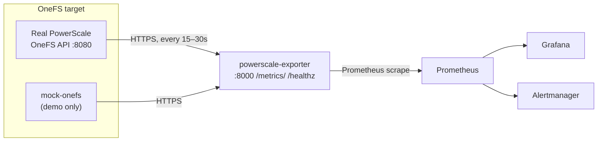

# PowerScale Prometheus Exporter

[](https://github.com/chanawh/pscale-exporter/actions/workflows/ci.yml)

A Prometheus exporter for Dell PowerScale / Isilon storage clusters. It scrapes the OneFS API, auto-discovers the stat keys and endpoints the cluster actually supports, and exposes the results as Prometheus metrics — cluster health, per-node CPU/disk/network, drive health, capacity, quotas, NFS/SMB, and SyncIQ replication lag.

No PowerScale hardware? Every deployment path below has a **demo mode** that runs the exporter against an in-repo mock OneFS cluster instead.

## Features

- **Auto-discovery** — probes the OneFS API at startup and builds the stat map from what the cluster actually serves (no hardcoded key lists to rot)
- **Cluster + node + drive metrics** — health, CPU, memory, disk I/O, network, per-drive busy/latency/queue depth
- **Capacity, quotas, NFS/SMB, SyncIQ** — the storage-level picture, not just host stats
- **Resilient scraper** — retries, timeouts, circuit breaker, tombstoned-node expiry
- **Mock OneFS** — a faithful fake OneFS API (`mock_onefs/`) so the whole stack runs with zero hardware
- **Hardened images** — multi-stage builds, non-root uid `10001`, read-only root filesystem
- **Three deployment paths** — Compose, Kustomize, Helm — all verified end-to-end

## Architecture



The exporter is a FastAPI app (`exporter/`). A background thread polls OneFS on `SCRAPE_INTERVAL`, caches the latest values, and serves them from `/metrics/` in Prometheus format. `/healthz` reports `{"status": "online", ...}` with discovery state (or `503` if the scraper thread has died).

## Quickstart

All three demo paths need no PowerScale hardware — they run against the mock.

### Option A — Docker Compose demo (fastest)

```bash
docker compose -f docker-compose.demo.yml up --build
```

Then open http://localhost:8000/metrics/ (note the trailing slash) and http://localhost:8000/healthz.

### Option B — kind + Kustomize demo

```bash
kind create cluster --name pscale-demo --image kindest/node:v1.32.0
kubectl apply -k k8s/demo/
kubectl -n powerscale-monitoring rollout status deploy/powerscale-exporter
kubectl -n powerscale-monitoring port-forward svc/powerscale-exporter-clusterip 8000:8000
```

> On Docker Desktop for Windows, pin `kindest/node:v1.32.0`: kind's default v1.37.0 node image fails to initialize there (`kubeadm init` never reaches a ready API server).

### Option C — Helm demo

```bash
helm install pscale ./helm/powerscale-exporter --set mock.enabled=true
kubectl -n powerscale-monitoring rollout status deploy/pscale-powerscale-exporter
kubectl -n powerscale-monitoring port-forward svc/pscale-powerscale-exporter-clusterip 8000:8000
```

## Against a real cluster

### Helm (recommended)

```bash
helm install pscale ./helm/powerscale-exporter \
  --set isilon.host=10.0.0.5 \
  --set isilon.port=8080 \
  --set auth.user=monitor \
  --set auth.password='...'
```

Prefer a pre-created Secret over a command-line password:

```bash
kubectl -n powerscale-monitoring create secret generic onefs-creds \
  --from-literal=ISILON_USER=monitor --from-literal=ISILON_PASS='...'

helm install pscale ./helm/powerscale-exporter \
  --set isilon.host=10.0.0.5 \
  --set auth.existingSecret=onefs-creds
```

See `helm/powerscale-exporter/README.md` for the full values table.

### Kustomize

```bash
kubectl apply -k k8s/manifests/
kubectl -n powerscale-monitoring create secret generic powerscale-exporter-secrets \
  --from-literal=ISILON_USER=monitor --from-literal=ISILON_PASS='...'
```

Edit `ISILON_HOST` in `k8s/manifests/configmap.yaml` first.

### Docker Compose (full stack)

`docker-compose.yml` runs the exporter plus Prometheus, Grafana, and Alertmanager. For clusters reachable only via an SSH jump host, it also includes an optional `isilon-tunnel` service (set `MGMT_IP`, `JUMPHOST`, `SSH_KEY_DIR`):

```bash
ISILON_PASS='...' docker compose up -d
```

## Metrics

All series carry `cluster_name`. Node series add `node_id`; drive series add `node_id` + `drive_id`.

| Metric | Description |
|--------|-------------|
| `isilon_cluster_health` | Cluster health (1 = OK) |
| `isilon_cluster_capacity_bytes_total` / `isilon_cluster_capacity_bytes_used` | Capacity |
| `isilon_node_status` | Node status (1 = OK) |
| `isilon_node_cpu_value`, `isilon_node_cpu_user_pct`, `isilon_node_cpu_sys_pct`, `isilon_node_cpu_idle_pct` | Node CPU |
| `isilon_node_disk_busy_pct`, `isilon_node_disk_iops_in`, `isilon_node_disk_iops_out` | Node disk I/O |
| `isilon_node_disk_bw_in_bytes`, `isilon_node_disk_bw_out_bytes` | Node disk throughput |
| `isilon_node_net_bytes_in`, `isilon_node_net_bytes_out` | Node network |
| `isilon_node_memory_used_bytes`, `isilon_node_memory_used_gb` | Node memory |
| `isilon_node_last_seen_seconds` | Last successful node scrape (unix ts) |
| `isilon_drive_health` | Drive health (1 = ok) |
| `isilon_drive_busy_pct`, `isilon_drive_latency_ms`, `isilon_drive_queue_depth` | Per-drive performance |
| `isilon_quota_total` | Number of quotas |
| `isilon_nfs_export_count`, `isilon_smb_share_count` | NFS exports / SMB shares |
| `isilon_replication_lag_seconds` | SyncIQ replication lag |
| `isilon_exporter_last_scrape_successful` | 1 if the last scrape succeeded |
| `isilon_exporter_api_errors_total` | Failed OneFS API calls |
| `isilon_exporter_scrape_duration_seconds` | Scrape duration (histogram) |

Plus the standard `python_*` / `process_*` series from `prometheus_client`.

## Monitoring & alerting

The full Compose stack (`docker-compose.yml`) ships a complete monitoring setup, all pre-wired:

- **Prometheus** — http://localhost:19091, scrapes the exporter every 15s (`monitoring/prometheus/prometheus.yml`)
- **Grafana** — http://localhost:13001, with the provisioned dashboard **"PowerScale Cluster - Complete Monitoring"**: 15 panels covering cluster health, capacity, node status, CPU, memory, network, disk I/O, drive health/performance, NFS/SMB shares, quotas, replication lag, and scrape duration
- **Alertmanager** — http://localhost:19093 (`monitoring/alertmanager/alertmanager.yml`)

14 alert rules (`monitoring/prometheus/alert-rules.yml`), all firing on metrics the exporter actually emits:

| Alert | Condition |
|-------|-----------|
| `PowerScaleClusterDown` / `PowerScaleNodeDown` / `PowerScaleDriveFailure` | health == 0 |
| `PowerScaleCriticalCPU` / `PowerScaleHighCPU` | CPU user % > 95 / 80 |
| `PowerScaleCriticalCapacity` / `PowerScaleHighCapacity` | used / total > 0.95 / 0.85 |
| `PowerScaleHighDiskBusy` | disk busy % > 90 |
| `PowerScaleHighDriveLatency` | drive latency > 50ms |
| `PowerScaleReplicationStalled` / `PowerScaleReplicationLag` | lag > 3600s / 300s |
| `PowerScaleExporterDown` / `PowerScaleExporterSlow` / `PowerScaleClusterDegraded` | exporter health / scrape duration |

## Configuration

| Variable | Default | Description |
|----------|---------|-------------|
| `ISILON_HOST` | _(none — required)_ | PowerScale cluster hostname/IP |
| `ISILON_PORT` | `8080` | OneFS API port |
| `ISILON_USER` | `root` | OneFS API user |
| `ISILON_PASS` | _(none — required, fail-fast)_ | OneFS API password |
| `SCRAPE_INTERVAL` | `30` | Scrape interval (seconds) |
| `TOMBSTONE_TTL` | `86400` | Seconds before a silent node is dropped |
| `LOG_LEVEL` | `INFO` | Log level |
| `MAX_RETRIES` / `TIMEOUT` / `CIRCUIT_BREAKER_THRESHOLD` | `3` / `30` / `5` | Scraper resilience tuning |

## Security / hardening

- Exporter and mock images are multi-stage builds running as non-root `appuser` (uid `10001`) with a read-only root filesystem (the mock keeps a writable `emptyDir` at `/certs` for its startup-generated TLS cert).
- The Kubernetes manifests include a NetworkPolicy: ingress only on `:8000`, egress only to DNS and the OneFS API port (plus 80/443).
- Credentials are never defaulted: `ISILON_PASS` is fail-fast when unset. Prefer `auth.existingSecret` / a pre-created Secret over passing passwords on a command line.
- Dependencies are hash-pinned (`requirements.txt` generated from `requirements.in`); CI runs `pip-audit`.

## Development

```bash
pytest test/                    # unit tests
black --check .                 # formatting
ruff check .                    # lint
mypy exporter/                  # types
pip-audit                       # dependency vulnerabilities
```

CI (`.github/workflows/ci.yml`) runs the same checks on Python 3.11 and 3.12, builds both images, and publishes `awhchan/powerscale-exporter` and `awhchan/powerscale-mock-onefs` to Docker Hub from `main`. The EKS deploy job is manual-only (`workflow_dispatch`).

## Project structure

```
.
├── exporter/                  # exporter app (main.py, scraper.py)
├── mock_onefs/                # mock OneFS API for hardware-free demos
├── test/                      # unit tests
├── k8s/
│   ├── manifests/             # base kustomization (real cluster)
│   └── demo/                  # demo overlay (mock in-cluster)
├── helm/
│   └── powerscale-exporter/   # Helm chart (demo + real-cluster modes)
├── monitoring/                # Prometheus / Grafana / Alertmanager configs
├── docker-compose.yml         # full stack (+ optional SSH tunnel)
├── docker-compose.demo.yml    # demo stack (mock + exporter)
└── Dockerfile
```

## Troubleshooting

- **kind cluster never becomes ready on Docker Desktop** — pin the node image: `kind create cluster --image kindest/node:v1.32.0` (v1.37.0 fails to initialize on cgroup v1 hosts).
- **`/metrics` redirects** — the app mounts at `/metrics/` with a trailing slash.
- **Exporter won't start: `ISILON_PASS` error** — the password has no default by design; set it.
- **No `isilon_drive_*` series** — the mock image predates the drive-ID fix; pull the current `awhchan/powerscale-mock-onefs:latest`.
- **Exporter can't reach the cluster** — check `/healthz` (`active_stat_map` shows what discovery found) and the exporter logs for API errors.

## Contributing

1. Fork, branch from `main`, make your change.
2. Add/adjust tests; keep `black`, `ruff`, `mypy`, and `pip-audit` clean.
3. Open a PR — CI must be green before merge.

## License

MIT — see [LICENSE](LICENSE).
